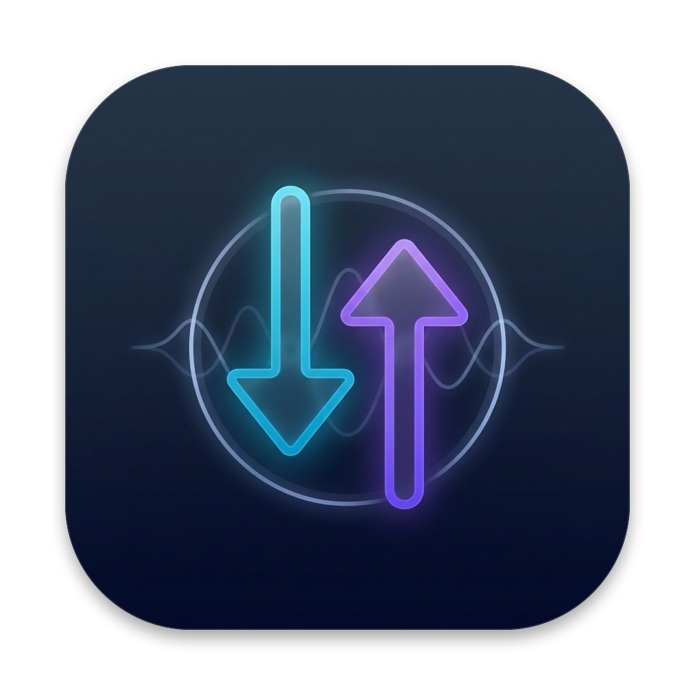
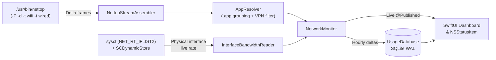

<div align="center">



# Datawatcher

**Native macOS per-app network usage monitor — 100% local, zero cloud, real-time menu bar telemetry.**

*Monitor de consumo de red por aplicación para macOS — 100% local, sin nube y con telemetría en tiempo real en la barra de menú.*


</div>

---

## ✨ Highlights / Características principales

- **📡 Per-App Traffic Attribution** — Streams live delta frames from macOS `/usr/bin/nettop` across Wi-Fi and Wired interfaces (`-t wifi -t wired`) and automatically rolls up helper processes (e.g., browser renderers, XPC helpers) into their parent `.app` bundle.
- **🛡️ VPN-Aware Accuracy** — Measures total live interface throughput directly from the macOS kernel via `sysctl(NET_RT_IFLIST2)` (`en0`, `en1`, etc.) while filtering out L3 VPN tunnel daemons/extensions (`utun*`, `wireguard`, `tailscaled`, `openvpn`, `cloudflare-warp`, etc.) to prevent double-counting.
- **📊 Interactive Swift Charts Dashboard** —
  - **Traffic Over Time**: Stacked Download/Upload bar chart with automatic hourly, daily, weekly, or monthly bucketing and hover inspection.
  - **Top Applications & Live Throughput**: Switchable donut breakdown and real-time 60-second area chart.
  - **KPI Cards & App Table**: Search by app name or bundle ID, sort by Total / Download / Upload / Live Speed / Name, toggle system processes, and click any app to filter the entire dashboard.
- **🧭 Menu Bar Tray Mode** — Closing the main window hides the Dock icon (`NSApplication.ActivationPolicy.accessory`) and keeps monitoring quietly from `NSStatusItem` with stacked live `↓ / ↑` speeds, optional icon hiding, a quick-view popover (top 5 apps today), and a right-click context menu.
- **🗄️ 100% Local SQLite History** — Persists hourly per-app totals in WAL-mode SQLite (`~/Library/Application Support/Datawatcher/usage.sqlite`), relocatable at runtime to any folder you choose from Settings.
- **🌐 Instant Bilingual UI (`EN` / `ES`)** — Auto-detects system locale on first launch and switches instantaneously between English and Español.
- **🚀 Launch at Login & CSV Export** — Background startup via per-user `LaunchAgent` (`--background`) and one-click CSV export for any selected date range or app.

---

## 🏗️ How It Works



1. **Streaming Without Baseline Spikes**: `NettopStreamAssembler` discards `nettop`'s Frame 1 cumulative snapshot and processes only subsequent delta frames (`2+`), clamping kernel socket-reset artifacts to `0`.
2. **Physical Interface Ground Truth**: `InterfaceBandwidthReader` resolves the primary non-virtual interface (`en0`, `en1`, …) via `SystemConfiguration` / `getifaddrs` and computes live `↓ / ↑` speeds with physical baudrate sanity bounds.
3. **Smart Bundle Grouping**: `AppResolver` walks executable paths (`proc_pidpath`) to the outermost `.app` bundle so multi-process apps (e.g., Chrome, Safari, Electron apps) appear as a single clean entry with their native icon.

---

## ⚙️ Settings & Customization

Inside **Settings** (`⌘` / gear icon), you can configure:

| Setting | Options / Behavior |
| :--- | :--- |
| **Interface Language** | `English` / `Español` (live switch, saved in `UserDefaults`) |
| **Polling Interval** | `2 sec`, `3 sec`, or `5 sec` |
| **Menu Bar Display** | Show live `↓ / ↑` speeds, optionally hide the status bar icon when speeds are shown |
| **System Processes** | Include or hide system daemons & non-app processes by default |
| **Launch at Login** | Writes/removes `~/Library/LaunchAgents/com.datawatcher.app.plist` with `--background` |
| **Database Location** | Relocate `usage.sqlite` at runtime (move current, use existing, or overwrite) & export/clear history |

> [!NOTE]
> Window size, screen position, and fullscreen state are persisted automatically across launches and tray hides.

---

## 🛠️ Build, Test & Package

### Requirements

- **macOS 14.0+** (Sonoma or newer)
- **Swift 6.0** toolchain (Xcode 16+ or Xcode Command Line Tools)

### Commands

```bash
# 1. Build (debug)
swift build

# 2. Run unit tests (with Xcode.app selected)
swift test

# 3. Run unit tests (Command Line Tools only, without Xcode.app)
swift test \
  -Xswiftc -F -Xswiftc /Library/Developer/CommandLineTools/Library/Developer/Frameworks \
  -Xlinker -F -Xlinker /Library/Developer/CommandLineTools/Library/Developer/Frameworks \
  -Xlinker -rpath -Xlinker /Library/Developer/CommandLineTools/Library/Developer/Frameworks \
  -Xlinker -rpath -Xlinker /Library/Developer/CommandLineTools/Library/Developer/usr/lib

# 4. Build release .app bundle
chmod +x scripts/build_app.sh
./scripts/build_app.sh

# 5. Launch the packaged app
open build/Datawatcher.app
```

---

## 📁 Project Structure

```text
Datawatcher/
├── Package.swift                                  # SwiftPM manifest (DatawatcherCore + Datawatcher + DatawatcherTests)
├── Resources/
│   ├── AppIcon.icns                               # macOS app bundle icon
│   └── AppIcon.png                                # Source icon artwork
├── scripts/
│   └── build_app.sh                               # Release build & .app bundler (build/Datawatcher.app)
├── Sources/
│   ├── DatawatcherCore/                           # Platform services, parsing, persistence & localization
│   │   ├── Localization/L10n.swift                # Exhaustive EN/ES strings + LanguageManager
│   │   ├── Models/Models.swift                    # AppRecord, AppUsageSummary, presets & chart models
│   │   ├── Services/
│   │   │   ├── AppResolver.swift                  # Outermost .app resolution, VPN tunnel filter, icon cache
│   │   │   ├── InterfaceBandwidthReader.swift     # sysctl(NET_RT_IFLIST2) physical interface speed reader
│   │   │   ├── LaunchAtLoginManager.swift         # Per-user LaunchAgent plist manager
│   │   │   ├── NettopParser.swift                 # nettop CSV parser, DeltaTracker & NettopStreamAssembler
│   │   │   ├── NetworkMonitor.swift               # Persistent nettop streaming engine & wake recovery
│   │   │   └── UsageDatabase.swift                # Thread-safe SQLite WAL store + runtime relocation & CSV
│   │   └── Utils/ByteFormatter.swift              # Human-readable byte & speed formatters
│   └── Datawatcher/                               # macOS AppKit + SwiftUI application target
│       ├── main.swift                             # NSApplication bootstrap & --background handling
│       ├── AppDelegate.swift                      # Window lifecycle, tray NSStatusItem & NSPopover
│       ├── DashboardViewModel.swift               # Period filters, sorting, search & chart queries
│       └── Views/                                 # MainWindowView, ChartsSectionView, AppListView, etc.
└── Tests/
    └── DatawatcherTests/DatawatcherTests.swift    # Swift Testing suite for DatawatcherCore
```

---

## 🔒 Privacy

Datawatcher collects **zero telemetry**. All traffic parsing and SQLite storage happen exclusively on your Mac; no network requests are made by the app itself.
